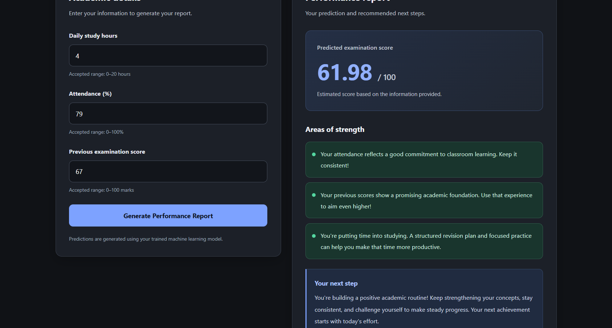

# 🎓 Student Performance Predictor

### Machine Learning-Based Exam Score Prediction

A Machine Learning web application that predicts students' exam scores based on academic factors such as study hours, attendance, and previous scores.

<p align="center">
  <a href="https://student-performance-predictor-psyy.onrender.com">
    
  </a>
  
  
  
</p>

---

## 🚀 Live Demo

Try the application here:

**[Open Student Performance Predictor](https://student-performance-predictor-psyy.onrender.com)**

Enter the required academic details and explore the predicted exam score.

> Note: The application may take a little time to load if the free hosting service has been inactive.

## 📌 Project Overview

Student performance depends on several factors, including study habits, attendance, and previous academic results.

This project uses a trained Machine Learning model to estimate exam scores based on the provided inputs. A Flask-based web interface allows users to enter academic details and view predictions easily.

The project demonstrates how Machine Learning can be integrated into a practical web application.

## ✨ Features

- 🎯 Exam score prediction using Machine Learning
- 🧠 Linear Regression model
- 🌐 Simple and interactive web interface
- 📊 Model evaluation using R² score and Mean Absolute Error
- ⚡ Real-time predictions through a Flask application
- ☁️ Cloud deployment using Render
- 📂 Well-organized project structure

## 🛠️ Technologies Used

| Technology | Purpose |
|---|---|
| Python | Core programming language |
| Pandas | Data handling and analysis |
| NumPy | Numerical computations |
| Matplotlib | Data visualization |
| Scikit-learn | Model training and evaluation |
| Flask | Web application framework |
| Gunicorn | Production WSGI server |
| HTML and CSS | User interface |
| Render | Application deployment |

## ⚙️ How It Works

1. **Input:** The user enters the required academic details.
2. **Preprocessing:** The application prepares the inputs in the format expected by the model.
3. **Prediction:** The trained Linear Regression model estimates the exam score.
4. **Output:** The predicted score is displayed on the web page.

## 📊 Model Performance

The model was evaluated using a held-out test dataset.

| Evaluation Metric | Result |
|---|---:|
| Test R² Score | 0.5156 |
| Mean Absolute Error (MAE) | 1.4631 |
| Cross-validation Mean R² | 0.5912 |

### Interpretation

- **R² Score — 0.5156:** The model explains approximately 51.56% of the variation in exam scores in the evaluated test dataset.
- **MAE — 1.4631:** Predictions differ from actual scores by approximately 1.46 score units on average.
- **Cross-validation Mean R² — 0.5912:** The average R² score across the evaluated cross-validation folds is approximately 0.5912.

These metrics describe the model's performance on the evaluated data. Actual performance may vary on new datasets.

## 📸 Screenshots

### 🏠 Home Page


### 📈 Prediction Results




## 📂 Project Structure

```text
Student-Performance-Predictor/
│
├── app.py
├── model.pkl
├── student_performance.ipynb
├── StudentPerformanceFactors.csv
├── requirements.txt
├── MODEL_REPORT.md
├── README.md
├── .gitignore
│
├── templates/
│   └── index.html
│
├── static/
│   └── style.css
│
└── screenshots/
    ├── homepage.png
    └── prediction-results.png
```

## 💻 Run Locally

Follow these steps to run the application on your computer.

### 1. Clone the repository

```bash
git clone https://github.com/Gurusivasai-sunkari/Student-Performance-Predictor.git
```

### 2. Navigate to the project directory

```bash
cd Student-Performance-Predictor
```

### 3. Create a virtual environment

```bash
python -m venv venv
```

Activate it on Windows:

```bash
venv\Scripts\activate
```

### 4. Install the dependencies

```bash
pip install -r requirements.txt
```

### 5. Start the application

```bash
python app.py
```

Open the local URL shown in the terminal, usually:

```text
http://127.0.0.1:5000
```

## 🔮 Future Improvements

- Experiment with additional regression algorithms.
- Improve predictive performance through feature engineering.
- Add interactive charts and student performance insights.
- Evaluate the model on larger and more diverse datasets.
- Improve the user interface and accessibility.
- Provide more detailed, data-driven study recommendations.

## ⚠️ Disclaimer

This project is intended for educational and demonstration purposes. Predicted scores are estimates generated by a Machine Learning model and should not be considered guaranteed exam results or definitive assessments of a student's abilities.

## 👨‍💻 Author

**Guru Siva Sai**

- **GitHub Profile:** [Gurusivasai-sunkari](https://github.com/Gurusivasai-sunkari)
- **Project Repository:** [Student Performance Predictor](https://github.com/Gurusivasai-sunkari/Student-Performance-Predictor)
- **Live Application:** [Try the Live Demo](https://student-performance-predictor-psyy.onrender.com)

---

<p align="center">
  <b>Built with Python, Machine Learning, and Flask ❤️</b>
</p>
